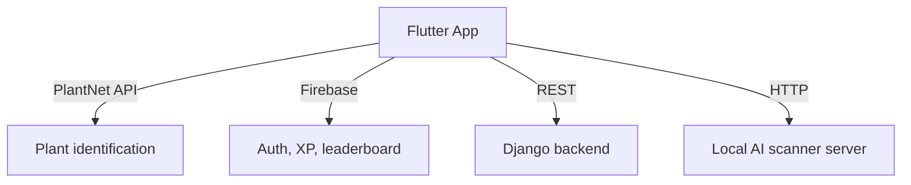

# 🌍 GeoCampus

GeoCampus is a serious game for campus sustainability: a Flutter mobile app where students explore the campus on a live GPS map, scan real plants with AI, fill a campus Pokédex, take a daily SDG quiz and play eco mini-games — all feeding one XP / Eco Coins / leaderboard loop.

---

## ✨ Features

- **Live campus map**: your GPS position on the campus map, with 20 real campus plants to discover. The camera follows you until you pan, and the recenter button turns following back on.
- **AI plant scanner**: photograph a plant and PlantNet identifies it. A targeted scan only completes the target plant when the species matches; anything else is logged as a new find.
- **Campus Pokédex**: every species you discover, with confidence and your photo.
- **Rewards**: XP and Eco Coins are synced to Firebase and show up on the leaderboard.
- **Daily SDG quiz and streaks**: one quiz per day, plus a daily play streak.
- **Mini-games**: Light Saver, Crush the Plastic, Guardian of the Forest.

---

## 🏗️ Architecture



| Part | Path | Role |
|---|---|---|
| Flutter app | `frontend/` | The game (map, scanner, hub, mini-games) |
| Django backend | `backend/campus_sustainability/` | Quests, events, leaderboard API |
| AI scanner server | `backend/plant_recognition/` | Python PlantNet relay on port 8888 |
| Web map (legacy) | `web_assets/send2/` | Browser version of the campus map |

---

## 🚀 Quick start

### Prerequisites
- Flutter SDK (stable)
- Python 3.10+
- An Android phone in developer mode, on the same Wi-Fi as your PC

### 1. Backend
```bash
cd backend/campus_sustainability
pip install -r requirements.txt
cp streatham_go/streatham_go/.env.example streatham_go/streatham_go/.env   # then fill in the values
cd streatham_go
python manage.py migrate
python manage.py loaddata games.json buildings.json
python manage.py runserver 0.0.0.0:8000
```

### 2. Scanner + web map servers (Windows)
```powershell
./run_geocampus.bat
```

### 3. App
Find your PC's IP with `ipconfig`, then:
```bash
cd frontend
flutter run --dart-define=GEOCAMPUS_API=http://YOUR_PC_IP:8000/api/v1
```

Or install the APK from the [latest release](../../releases/latest).

---

## 🔥 Firebase setup (required to build the app)

The Firebase config files are **not** in this repo, because they contain API keys. Connect the app to your own Firebase project:

```bash
dart pub global activate flutterfire_cli
cd frontend
flutterfire configure   # generates lib/firebase_options.dart and google-services.json
```

Enable **Authentication (email/password)** and **Cloud Firestore** in your Firebase console. `frontend/lib/firebase_options.example.dart` shows the expected format.

---

## 🌿 Get your PlantNet API key (required for the scanner)

The project does **not** ship with a PlantNet key. Each user brings their own free key:

1. Create a free account at **[my.plantnet.org](https://my.plantnet.org)**.
2. Open your account settings and copy your **API key** (the free plan includes 500 identifications per day).
3. Add it to the app in one of two ways:
   - **In the app**: open the scanner and tap the 🔑 icon (top right), or just scan a plant and the app will ask for the key. It is saved only on your phone.
   - **At build time**: `flutter run --dart-define=PLANTNET_API_KEY=your-key`
4. For the Python scanner server, set the environment variable before starting it:
   ```powershell
   set PLANTNET_API_KEY=your-key      # Windows (cmd)
   export PLANTNET_API_KEY=your-key   # macOS / Linux
   ```

---

## 🔑 Configuration

| Setting | Where |
|---|---|
| Django secret key, Google API key | `backend/campus_sustainability/streatham_go/streatham_go/.env` (copy `.env.example`) |
| Django API address used by the app | `--dart-define=GEOCAMPUS_API=...` (`frontend/lib/services/api_service.dart`) |
| PlantNet API key (app) | 🔑 button in the scanner, or `--dart-define=PLANTNET_API_KEY=...` |
| PlantNet API key (server) | `PLANTNET_API_KEY` environment variable |

---

## 🛰️ Troubleshooting

- **GPS stuck on "Loading campus map"**: grant location permission and enable location services.
- **Scanner asks for a key or says it was rejected**: tap 🔑 in the scanner and paste your key from [my.plantnet.org](https://my.plantnet.org) (see above).
- **App can't reach the backend**: the phone and PC must be on the same network, and the IP passed in `GEOCAMPUS_API` must match `ipconfig`.
